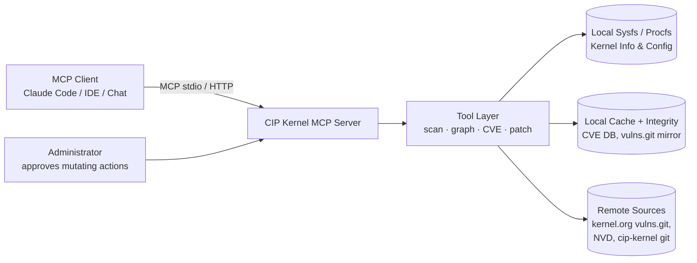

# CIP Kernel MCP Server

**An open-source MCP (Model Context Protocol) server engine for Linux system administrators managing systems on CIP super-long-term-support (SLTS) kernels (5.10.x) — built to accelerate dependency discovery and security patch implementation.**

## 1. Motivation

The [Civil Infrastructure Platform (CIP)](https://www.cip-project.org/) maintains SLTS Linux kernels (currently 5.10.x, supported 10+ years) that power bridges, tunnels, railways, power plants, and other industrial systems. Administrators of these systems face a specific set of hard problems:

- **Dependency opacity.** A production CIP image combines a pinned kernel, distro packages, out-of-tree drivers, firmware blobs, and custom daemons. Answering *"what depends on this kernel symbol / library / driver version?"* currently requires slow, manual cross-referencing.
- **Slow CVE triage.** A CVE arrives in `kernel-5.10.x`. The admin must determine whether the affected subsystem is even enabled in the deployed kernel config, whether a fix is already in a CIP branch, and what backport a custom kernel requires.
- **Fragmented tooling.** `cve-tracker` data, NVD, kernel configs, `modinfo`, SBOM scanners, and patch sets live in disconnected silos.
- **10-year maintenance windows.** Long-lived deployments mean patches must be **backported**, not upgraded — which makes every change riskier and every dependency fact more valuable.

**CIP Kernel MCP Server** closes this gap by exposing these silos as structured, queryable MCP tools so that any MCP-capable LLM agent (Claude Code, IDE assistants, chat agents) can assist the admin with accurate, machine-verified facts.

## 2. Goals

1. Give LLM agents **fast, structured access to dependency information** for systems running CIP 5.10.x kernels.
2. Help administrators **triage CVEs and implement security patches** faster and more safely.
3. Remain **fully open source** (MIT), community-driven, and vendor-neutral.
4. Be **read-only by default** — analysis first; any mutating action is explicit, audited, and gated.

### Non-goals

- Replacing a package manager, build system, or patch pipeline.
- Auto-applying patches to production without human approval.
- Supporting non-LTS or non-CIP kernel branches (initially; other SLTS kernels may follow).

## 3. Core Capabilities (MCP Tools)

| Tool | Purpose | Phase |
| --- | --- | --- |
| `scan_system` | Collect a read-only machine inventory: kernel version, config (`/proc/config.gz` → `/boot/config-*` → IKCONFIG extraction from the kernel image), loaded modules, distro. | P0 |
| `query_cve` | Look up a CVE: kernel.org cve records first (commit-keyed), NVD fallback. Normalized record with affected files, version ranges, and fixing commits. | P0 |
| `cve_applicability` | Two gates: version range (fix already present / not introduced) and config mapping → **applicable / not applicable / unknown**, always with an evidence chain. | P0 |
| `find_patches` | Locate existing fixes: mainline → stable → CIP branches; live linux-cip mirror queries resolve the CIP backports (commit, first tagged CIP release). | P0 |
| `dependency_graph` | Build and query a dependency graph: kernel symbols ↔ modules ↔ drivers ↔ packages ↔ services. | P1 |
| `patch_builder` | Draft a kernel-rule-compliant backport into a staging directory; conflict report. | P1 |
| `release_tracker` | Per installed CIP release: fixed vs outstanding CVEs, update recommendation. | P1 |
| `config_audit` | Audit kernel config against hardening baselines (CIP hardening guide / IEC 62443). | P2 |
| `sbom_export` | Emit a CycloneDX/SPDX SBOM of the scanned system, including kernel and module inventory. | P2 |

## 4. Architecture

Modular engine in five layers, from the MCP runtime to the product surface.
Full module catalog, governing rules (R1–R8), and implementation priorities: [docs/ARCHITECTURE.md](docs/ARCHITECTURE.md).



- **Transport:** stdio (local admin workstation); streamable HTTP team server in P3.
- **Safety model:** tools are read-only by default; no tool touches a running system.
- **Safety & security model:** [docs/THREAT-MODEL.md](docs/THREAT-MODEL.md).

## 5. Security Principles

1. **Read-only by default** — inventory and analysis require no privileges beyond reading.
2. **Least privilege** — no root requirement for scanning; agents run as a dedicated user.
3. **Explicit approval** — every state-changing operation requires a human confirmation step.
4. **Full audit trail** — every tool invocation is logged with hash-chained digests of inputs and outputs.
5. **Deterministic outputs** — verdicts never guess and always include their evidence chain.

## 6. Status

Phase **P0 (MCP Foundation)** — engine implemented:

- Engine core: MCP runtime (stdio), hash-chained audit trail, offline-first cache, source-integrity hooks, tool registry.
- System inventory: kernel-config fallback chain — `/proc/config.gz` → distro `/boot/config-<release>` → IKCONFIG blob extracted from the kernel image (`CONFIG_IKCONFIG`); disabled options (`# CONFIG_X is not set`) are normalized to `=n` so the applicability config gate can rule subsystems out; the resolved source is reported as `configSource` (limitation: compressed bzImage payloads are not unwrapped — such hosts should ship `/boot/config-*` or enable `CONFIG_IKCONFIG_PROC`).
- CVE chain: **kernel.org cve records via [vulns.git](https://git.kernel.org/pub/scm/linux/security/vulns.git/)** (CVE JSON 5.0: affected files, per-series version ranges from `cpeApplicability`, commit-keyed fixing commits) with NVD fallback; a provider that is unavailable (no git CLI, air-gapped host) is skipped.
- Patch provenance: **live [linux-cip mirror](https://git.kernel.org/pub/scm/linux/kernel/git/cip/linux-cip.git/) queries** — metadata-only cached clone of the CIP kernel repo; backports matched via the upstream fixing sha (`commit <sha> upstream.` / `Fixes:` lines, Rule R4), each reported with the first tagged CIP release containing it (e.g. `v5.10.163-cip35`) and a browsable commit URL; branches without a backport get an explicit negative signal; degrades to record-derived candidates when offline.
- Analysis: CVE applicability engine with two evidence-backed gates — version range (fix already present / not introduced) and config/module mapping; patch locator per stable series with CIP backport resolution.
- MCP tools: `scan_system`, `query_cve`, `find_patches`, `cve_applicability`.
- CI (Node 20/22: type-check, tests, build), vitest coverage for engine and analysis modules.

Requires the `git` CLI on the host (for the vulns.git and linux-cip mirrors); the NVD fallback needs no git.

## 7. Tech Stack

- **Language:** TypeScript (Node.js ≥ 20) — chosen at kickoff; the official MCP SDK is TypeScript-first, giving a single-language engine + provider SDK. Python provider examples may follow in P3.
- **MCP SDK:** official [Model Context Protocol SDK](https://github.com/modelcontextprotocol/typescript-sdk) (server side, stdio transport).
- **Data:** kernel.org vulns.git mirror + linux-cip mirror (git CLI) + NVD API, behind the offline-first JSON cache.
- **CI:** GitHub Actions on Node 20/22 with vitest.

## 8. Development

```bash
npm install
npm run lint     # type-check (tsc --noEmit)
npm test         # vitest
npm run build    # compile to dist/
npm start        # run the MCP server over stdio
```

Point your MCP client's stdio command at `node dist/index.js`. Environment overrides:

- `CIP_MCP_CACHE_DIR` — cache directory (default `.cip-mcp-cache`)
- `CIP_MCP_AUDIT_LOG` — audit log path (default `.cip-mcp-audit.log`)
- `CIP_MCP_VULNS_DIR` — kernel.org vulns.git mirror location (default `<cache>/vulns`)
- `CIP_MCP_MIRROR_DIR` — linux-cip mirror location (default `<cache>/linux-cip`)
- `CIP_MCP_MIRROR_URL` — linux-cip mirror URL override (default `git.kernel.org`)

Contribution rules: [CONTRIBUTING.md](CONTRIBUTING.md).

## 9. License & Contribution

MIT licensed. Contributions welcome: kernel triage expertise, MCP tool ideas, CVE data quality, and docs for industrial deployment scenarios are the most valuable first contributions.

## 10. Repository Layout

```
.
├── README.md
├── CONTRIBUTING.md
├── docs/
│   ├── ARCHITECTURE.md       # modular architecture, rules R1-R8, priorities P0-P3
│   └── THREAT-MODEL.md       # safety & security model
├── src/
│   ├── index.ts              # MCP server entry (stdio)
│   ├── engine/               # L0: types, runtime, audit, cache, integrity, registry
│   ├── providers/            # L1: system inventory, kernel.org cve, NVD, CIP git, cve-service
│   ├── analysis/             # L2: CVE applicability, version ranges, patch locator
│   └── tools/                # L3: MCP tool wiring
├── tests/
└── .github/                  # CI workflow, issue templates
```
