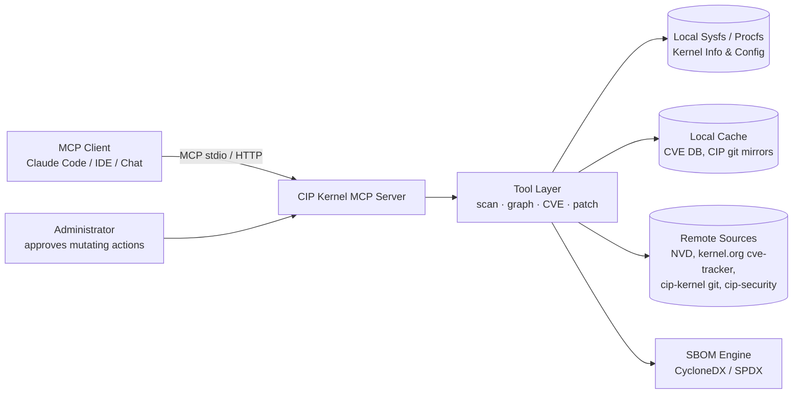

# CIP Kernel MCP Server

**An open-source MCP (Model Context Protocol) server engine for Linux system administrators managing systems on CIP super-long-term-support (SLTS) kernels (5.10.x) — built to accelerate dependency discovery and security patch implementation.**

## 1. Motivation

The [Civil Infrastructure Platform (CIP)](https://www.cip-project.org/) maintains SLTS Linux kernels (currently 5.10.x, supported 10+ years) that power bridges, tunnels, railways, power plants, and other industrial systems. Administrators of these systems face a specific set of hard problems:

- **Dependency opacity.** A production CIP image combines a pinned kernel, distro packages, out-of-tree drivers, firmware blobs, and custom daemons. Answering *"what depends on this kernel symbol / library / driver version?"* currently requires slow, manual cross-referencing.
- **Slow CVE triage.** A CVE arrives in `kernel-5.10.x`. The admin must determine whether the affected subsystem is even enabled in the deployed kernel config, whether a fix is already in the CIP/`cip-security` branch, and what backport a custom kernel requires.
- **Fragmented tooling.** `cve-tracker` data, NVD, kernel configs, `modinfo`, SBOM scanners, and patch sets live in disconnected silos.
- **10-year maintenance windows.** Long-lived deployments mean patches must be **backported**, not upgraded — which makes every change riskier and every dependency fact more valuable.

**CIP Kernel MCP Server** closes this gap by exposing these silos as structured, queryable MCP tools so that any MCP-capable LLM agent (Claude Code, IDE assistants, chat agents) can assist the admin with accurate, machine-verified facts.

## 2. Goals

1. Give LLM agents **fast, structured access to dependency information** for systems running CIP 5.10.x kernels.
2. Help administrators **triage CVEs and implement security patches** faster and more safely.
3. Remain **fully open source** (MIT), community-driven, and vendor-neutral.
4. Be **read-only by default** — analysis first; any mutating action is explicit, audited, and gated.

### Non-goals

- Replacing a package manager, build system, or patch pipeline.
- Auto-applying patches to production without human approval.
- Supporting non-LTS or non-CIP kernel branches (initially; other SLTS kernels may follow).

## 3. Core Capabilities (MCP Tools)

| Tool | Purpose |
| --- | --- |
| `scan_system` | Collect a machine inventory: kernel version (`uname -r`), config (`/proc/config.gz` or `Ikconfig`), loaded modules, distro, package list. |
| `dependency_graph` | Build and query a dependency graph: kernel symbols ↔ modules ↔ drivers ↔ packages ↔ services. Answers "what breaks if X changes?" |
| `query_cve` | Look up a CVE across NVD, the kernel.org `cve-tracker`, and the CIP security feeds; returns affected files, functions, and fixing commits for 5.10.x. |
| `cve_applicability` | Cross-reference a CVE against a concrete kernel config + module inventory → **applicable / not applicable / unknown**, with reasoning. |
| `find_patches` | Locate existing fixes: upstream stable 5.10.x backports, `cip-security` / `rt` branch commits, and distro patches. |
| `patch_builder` | Draft a backport: fetches the fixing commit, checks whether it applies cleanly to the target tree, and reports conflicts. |
| `config_audit` | Audit kernel config against hardening baselines and CVE-driven recommendations (e.g., "disable X, enable Y"). |
| `sbom_export` | Emit a CycloneDX/SPDX SBOM of the scanned system, including kernel and module inventory. |

## 4. Architecture



- **Transport:** stdio (local admin workstation) and streamable HTTP (team server).
- **Data sources:** local `/sys`, `/proc`, `modules.dep`, `Module.symvers`; local or remote git mirrors of `cip-kernel` and `cip-security`; NVD / kernel.org CVE feeds. All remote data is cached locally for air-gapped use.
- **Safety model:** tools are read-only by default. `patch_builder` writes to a staging directory only; no tool touches a running system.
- **Planned SDK / engine design:** a small core ("engine") plus pluggable providers, so the community can add sources (e.g., Debian CIP package tracker, Yocto recipes, Buildroot) without touching the core.

## 5. Security Principles

1. **Read-only by default** — inventory and analysis require no privileges beyond reading.
2. **Least privilege** — no root requirement for scanning; agents run as a dedicated user.
3. **Explicit approval** — every state-changing operation requires a human confirmation step (enforced by the client's MCP approval flow, documented for server operators).
4. **Full audit trail** — every tool invocation is logged locally (what was read, what was fetched, what was drafted).
5. **Deterministic outputs** — CVE applicability verdicts always include their evidence chain, so admins can verify the agent's reasoning.

See [docs/THREAT-MODEL.md](docs/THREAT-MODEL.md) for the detailed safety and security model.

## 6. Roadmap

- **M0 — Proof of concept:** `scan_system`, `query_cve`, `find_patches` against public CIP git + kernel.org CVE data.
- **M1 — Dependency intelligence:** `dependency_graph`, `cve_applicability`, `config_audit`.
- **M2 — Patch workflow:** `patch_builder` with backport conflict analysis; `sbom_export`.
- **M3 — Ecosystem:** provider SDK, Docker image, CI (self-hosted runner tests against real 5.10.x configs), community docs.

## 7. Tech Stack (proposed)

- **Language:** TypeScript (Node.js) or Python — decided with the community at kickoff; both have mature MCP SDKs.
- **MCP SDK:** official Model Context Protocol SDK (server side).
- **Data:** git2 bindings for kernel mirrors, SQLite/JSON cache for CVE data, CycloneDX tooling for SBOM.
- **CI:** GitHub Actions with matrix tests over representative CIP 5.10.x configs (including `cip-beacon` and realtime variants).

## 8. License & Contribution

MIT licensed. Contributions welcome: kernel triage expertise, MCP tool ideas, CVE data quality, and docs for industrial deployment scenarios are the most valuable first contributions.

## 9. Repository Layout (initial)

```
.
├── README.md            # this concept
├── LICENSE              # MIT
├── docs/
│   ├── CONCEPT.md       # extended design document (planned)
│   └── THREAT-MODEL.md  # safety & security model
├── src/                 # server + tools (post-kickoff)
└── .github/             # issue templates, CI
```
