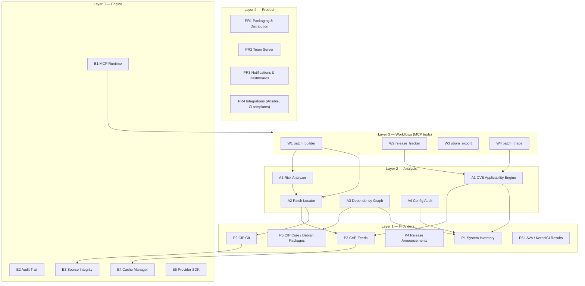
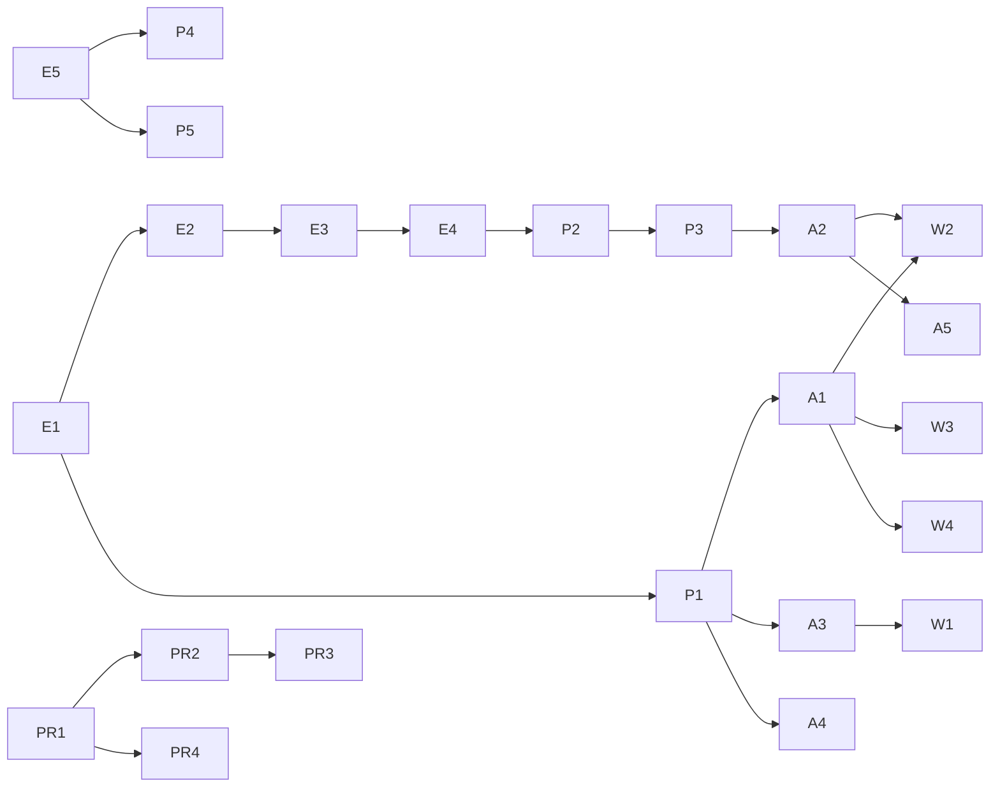

# CIP Kernel MCP Server — Modular Architecture & Implementation Priorities

This document defines the modular architecture of the CIP Kernel MCP Server and the
implementation priority path **from MCP foundation to product**. The architecture is
derived directly from the rules and processes of the Civil Infrastructure Platform (CIP),
the upstream Linux kernel stable/CVE policies, and IEC 62443 alignment work done by the
CIP Security Working Group — these rules are the foundation of this MCP server, not an
afterthought.

## 1. Governing rules (what CIP and the kernel community mandate)

Each rule below is extracted from CIP's own policies and upstream kernel documentation.
Every architectural decision in this document traces back to at least one of them.

| ID | Rule | Source |
| --- | --- | --- |
| R1 | **Upstream First.** CIP does not write its own security fixes; fixes are proposed upstream (mainline → stable), and only accepted fixes are incorporated into CIP kernels. The CIP WG maintains `cip-kernel-sec` to collect and analyze vulnerability information. | [CIP announcements](https://cip-project.org/news/announcements), [CIP security handling](https://cip-documents.readthedocs.io/en/latest/process/Security_issues_handling.html) |
| R2 | **SLTS scope.** CIP maintains SLTS series (4.4 → 2027, 4.19 → 2029, 5.10 → 2031, 6.1 → 2033) for 10+ years. After kernel.org LTS EOL, fixes become restricted to member-relevant architectures/hardware. Hardware backports must be non-intrusive and are accepted at the SLTS maintainers' discretion. | [CIP kernel maintenance policies](https://wiki.linuxfoundation.org/civilinfrastructureplatform/cipkernelmaintenance), [LF press release](https://www.linuxfoundation.org/press/civil-infrastructure-platform-expands-slt-stable-kernel-program) |
| R3 | **CVEs are commit-tracked.** The kernel CNA assigns CVEs to fixes in actively supported branches, tracked by the git commit id of the original fix. No CVEs are assigned for unsupported versions. Applicability is **not** determined upstream — it is the operator's responsibility. Taking whole stable updates is recommended over cherry-picking individual fixes. | [kernel.org CVE documentation](https://docs.kernel.org/process/cve.html), [stable kernel rules](https://docs.kernel.org/process/stable-kernel-rules.html) |
| R4 | **Backports are formalized.** A backport must reference the upstream commit ID in a separate `commit <sha> upstream` changelog line; deviations and conflict resolutions must be documented. | [Backporting and conflict resolution](https://docs.kernel.org/next/process/backporting.html) |
| R5 | **Sources, not binaries.** CIP releases sources; releases are signed by CIP developers. | [CIP kernel maintenance policies](https://wiki.linuxfoundation.org/civilinfrastructureplatform/cipkernelmaintenance), [CIP secure development process](https://cip-documents.readthedocs.io/en/latest/process/secure_development_process.html) |
| R6 | **No userspace ABI breaks.** In-kernel API/ABI stability is not guaranteed inside an SLTS branch, but incompatible changes to userspace APIs/ABIs are not acceptable; out-of-tree components are the member's responsibility. | [CIP kernel maintenance policies](https://wiki.linuxfoundation.org/civilinfrastructureplatform/cipkernelmaintenance) |
| R7 | **Everything is tested.** CIP changes go through GitLab CI builds of multiple configs, LAVA testing on CIP reference hardware (boot/healthcheck, LTP, cyclictest/hackbench for RT), KernelCI integration, plus static analysis (sparse, smatch, Coccinelle, checkpatch) and runtime sanitizers (KASAN/UBSAN/KMSAN). | [CIP testing process](https://cip-documents.readthedocs.io/en/latest/process/testing_process.html), [CIP announcements](https://cip-project.org/news/announcements) |
| R8 | **IEC 62443 alignment.** CIP maintains hardening guidelines and a secure development process targeting IEC 62443-4-1/-4-2 (SL-2/SL-3); requirements use RFC 2119 language; patch management and defect management are auditable processes. | [CIP hardening guide](https://cip-docs.readthedocs.io/en/latest/security/CIP_Security_Hardening/), [CIP IEC 62443](https://cip-project.org/about/security-iec-62443-4-2) |

## 2. From rules to architecture principles

| Rule | Architectural consequence |
| --- | --- |
| R1 | The server **never invents patches**. It locates existing upstream/stable/CIP fixes and drafts compliant backports. Every tool result carries the provenance chain (CVE → fixing commit → branch → release). |
| R2 | First-class entities are **SLTS series and branches** (`linux-5.10.y-cip`, `-rt`, …), not generic kernel versions. Analysis flags post-LTS-EOL restricted-support series. |
| R3 | The flagship tool is **`cve_applicability`**: the kernel's own policy says applicability is the operator's problem, and CVE volume makes it unmanageable by hand. Verdicts always include an evidence chain (config lines, module inventory, fixing commit). |
| R4 | `patch_builder` output follows the kernel backport format (`commit <sha> upstream` line, documented conflict resolutions) so results can be submitted to CIP/stable without rework. |
| R5 | The engine ships as source; all fetched artifacts are **signature-verified**; outputs are patches/sources, never binaries. |
| R6 | A **risk analyzer** flags proposed backports that touch userspace-visible ABI or look intrusive to other drivers (R2/R6 heuristics). |
| R7 | Every recommendation is annotated with **known test coverage** (LAVA/KernelCI jobs) and can suggest which CIP test jobs validate a change. |
| R8 | The audit trail, hardening baselines, and deterministic evidence chains are designed to be usable as **IEC 62443-4-1 process evidence**. |

## 3. Module architecture

Five layers, from the MCP engine at the bottom to the product surface at the top.
MCP tools are thin adapters: each tool composes one or more modules.

### Module catalog

| ID | Module | Layer | Purpose | Implements | Priority |
| --- | --- | --- | --- | --- | --- |
| E1 | MCP Runtime | 0 | stdio + streamable HTTP transports, tool registry, JSON-Schema validation of arguments, MCP approval hooks for sensitive operations | R1, R8 | **P0** |
| E2 | Audit Trail | 0 | Append-only, tamper-evident log of every invocation (tool, args, sources read, result digest) | R8 | **P0** |
| E3 | Source Integrity | 0 | Verify signatures on kernel.org CIP tarballs and git tags; pin mirrors; refuse unverifiable data | R5 | **P0** |
| E4 | Cache Manager | 0 | Offline-first cache of CVE feeds and git mirrors; every answer is stamped with data freshness | R2 | **P0** |
| E5 | Provider SDK | 0 | Public interfaces (`Provider`, `Analyzer`, `Workflow`) + test harness so the community can add sources | — | P1 |
| P1 | System Inventory | 1 | Kernel version, config, loaded modules, distro, packages from a whitelisted set of paths | R2, R3 | **P0** |
| P2 | CIP Git | 1 | Mirror/query `linux-cip` branches (`linux-5.10.y-cip`, `-rt`, `cip-kernel-sec`); track `Fixes:` tags and backport `commit <sha> upstream` lines | R1, R2, R4 | **P0** |
| P3 | CVE Feeds | 1 | kernel.org cve-tracker, NVD, Debian security tracker; normalize to commit-keyed records | R1, R3 | **P0** |
| P4 | Release Announcements | 1 | Parse CIP release announcements (`fixed CVEs:` lists per release) into a queryable ledger | R1, R3 | P1 |
| P5 | CIP Core / Debian Packages | 1 | Package-level dependency data for CIP Core (Debian-based) images | R6 | P1 |
| P6 | LAVA / KernelCI Results | 1 | Test-coverage lookups per branch, config, and board | R7 | P2 |
| A1 | CVE Applicability Engine | 2 | CVE × (config + module inventory) → **applicable / not applicable / unknown** with evidence chain | R3 | **P0** |
| A2 | Patch Locator | 2 | Find fixing commits: mainline → stable 5.10.y → CIP branches; resolve backport relations | R1, R4 | **P0** |
| A3 | Dependency Graph | 2 | Symbols ↔ modules ↔ drivers ↔ packages ↔ services; impact queries | R6 | P1 |
| A4 | Config Audit | 2 | Hardening baselines derived from the CIP hardening guide; CVE-driven recommendations | R8 | P2 |
| A5 | Risk Analyzer | 2 | Heuristics for intrusiveness (touching unrelated drivers) and userspace-ABI impact of a candidate backport | R2, R6 | P2 |
| W1 | Patch Builder | 3 | Draft kernel-rule-compliant backports into a staging dir; conflict report; never applies anything | R1, R4, R5 | P1 |
| W2 | Release Tracker | 3 | Per installed CIP release: fixed vs outstanding CVEs; update recommendation (whole-update preference per R3) | R3 | P1 |
| W3 | SBOM Export | 3 | CycloneDX/SPDX including kernel and module inventory | R8 | P2 |
| W4 | Batch Triage | 3 | Fleet-wide triage reports across multiple inventories | R3, R8 | P2 |
| PR1 | Packaging & Distribution | 4 | Docker image, DEB package, systemd unit, release signing | R5 | P2 |
| PR2 | Team Server | 4 | Multi-user HTTP deployment with MCP authorization layer | R8 | P3 |
| PR3 | Notifications & Dashboards | 4 | Webhooks, digest reports, CVE-drift alerts | R8 | P3 |
| PR4 | Integrations | 4 | Ansible role, GitLab CI templates matching CIP's test pipeline | R7 | P3 |

## 4. Implementation priorities — the "MCP → Product" path

Priorities are ordered so that each phase delivers a usable MCP capability on top of the
previous one, and the earliest phases cover the rules with the highest operational risk.

### Phase P0 — MCP Foundation *(target: first usable server)*

**Modules:** E1, E2, E3, E4, P1, P2, P3, A1, A2
**MCP tools shipped:** `scan_system`, `query_cve`, `find_patches`, `cve_applicability`
**Why first:** R1/R3 make provenance-correct CVE data the core value; without the
applicability engine the server is just a search wrapper. Engine modules (E2–E4) are
built here because retrofitting audit and integrity later is expensive.
**Exit criteria:** for a real CIP host, produce an evidence-backed applicability verdict
for any kernel.org CVE; verdicts validated against a manually-triaged sample set; full
offline mode works from cache.

### Phase P1 — Security Workflow *(target: end-to-end patch triage)*

**Modules:** E5, P4, P5, A3, W1, W2
**MCP tools shipped:** `dependency_graph`, `patch_builder`, `release_tracker`
**Why second:** completes the admin workflow — not only "does it affect me?" but "what
exactly do I pull, what does it touch, and what is my exposure per release?" `patch_builder`
follows the kernel backport format (R4) so drafts can go straight to CIP review.
**Exit criteria:** triage an entire CIP release end-to-end (outstanding CVEs → applicable
subset → draft backports with conflict reports); patch drafts pass `checkpatch.pl`.

### Phase P2 — Product Readiness *(target: deployable 1.0)*

**Modules:** P6, A4, A5, W3, W4, PR1
**Why third:** hardening baselines, risk heuristics, SBOM and fleet reporting turn the
server into a product that ops teams can adopt; packaging (Docker/DEB, signed releases)
closes R5 at the distribution level.

### Phase P3 — Team & Ecosystem

**Modules:** PR2, PR3, PR4
**Why last:** multi-user serving, dashboards, and CI integrations only matter once the
analysis core is trustworthy and packaged.

### Build order within phases

## 5. Rule-to-module traceability

| Rule | Modules implementing it |
| --- | --- |
| R1 Upstream First | P2, P3, A2, W1 (no patch invention anywhere) |
| R2 SLTS scope & non-intrusive backports | P1, P2, E4, A5 |
| R3 CVE policy & applicability | P3, A1, P4, W2, W4 |
| R4 Backport format | P2, A2, W1 |
| R5 Sources not binaries, signed | E3, W1, PR1 |
| R6 ABI stability & dependencies | A3, A5, P5 |
| R7 Test coverage | P6, PR4 |
| R8 IEC 62443 / audit | E2, A4, W3, PR2, PR3 |

## 6. Validated demand

The need for exactly this tooling was raised publicly on the CIP mailing list in July
2026: a member asked for *"a tool, dashboard, or documentation to determine the Kernel
CVEs applicable to a specific CIP release, which CVEs have already been fixed, and which
are still outstanding"*, plus guidance for safely backporting mainline-only fixes
([cip-dev thread](https://ratatoskr.run/cip-dev/2026/07/17234121)). Phase P0's
`cve_applicability` and Phase P1's `release_tracker` + `patch_builder` answer this
request directly.

## 7. Sources

- [CIP kernel maintenance policies](https://wiki.linuxfoundation.org/civilinfrastructureplatform/cipkernelmaintenance)
- [A Decade of Stability: 10 Years of the CIP Kernel WG](https://cip-project.org/blog/2026/08/06/a-decade-of-stability-10-years-of-the-cip-kernel-wg)
- [CIP expands SLTS kernel program (6.1)](https://www.linuxfoundation.org/press/civil-infrastructure-platform-expands-slt-stable-kernel-program)
- [Management of security issues in CIP](https://cip-documents.readthedocs.io/en/latest/process/Security_issues_handling.html)
- [CIP secure development process](https://cip-documents.readthedocs.io/en/latest/process/secure_development_process.html)
- [CIP security hardening guide (IEC 62443)](https://cip-docs.readthedocs.io/en/latest/security/CIP_Security_Hardening/)
- [CIP testing process (LAVA / KernelCI)](https://cip-documents.readthedocs.io/en/latest/process/testing_process.html)
- [kernel.org CVE documentation](https://docs.kernel.org/process/cve.html)
- [Stable kernel rules](https://docs.kernel.org/process/stable-kernel-rules.html)
- [Backporting and conflict resolution](https://docs.kernel.org/next/process/backporting.html)
- [CIP kernel releases (kernel.org)](https://www.kernel.org/pub/linux/kernel/projects/cip/5.10/)
- [cip-dev: CVE tracking request, July 2026](https://ratatoskr.run/cip-dev/2026/07/17234121)
